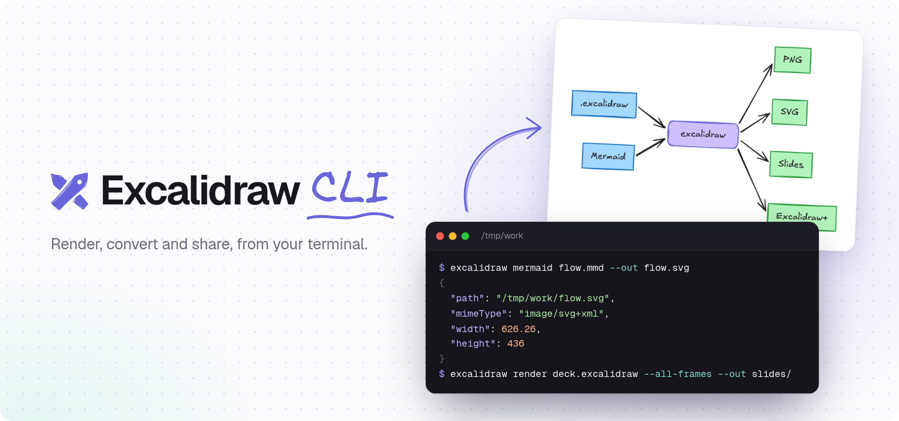

<p align="center">
  <picture>
    <source media="(prefers-color-scheme: dark)" srcset=".github/assets/banner-dark.png">
    
  </picture>
</p>

<p align="center">
  <a href="https://plus.excalidraw.com/docs/cli"><b>Documentation</b></a> ·
  <a href="https://www.npmjs.com/package/@excalidraw/cli">npm</a> ·
  <a href="https://plus.excalidraw.com">Excalidraw+</a> ·
  <a href="https://excalidraw.com">Excalidraw</a>
</p>

<p align="center">
  <a href="https://www.npmjs.com/package/@excalidraw/cli"></a>
  <a href="LICENSE"></a>
</p>

Render Excalidraw drawings and Mermaid diagrams from your terminal, free and without an account. With an [Excalidraw+](https://plus.excalidraw.com) API key, manage your workspace too.

## Features

- 🖼️ **Render to PNG or SVG**: any `.excalidraw` file, light or dark, transparent, up to 16× scale.
- 🎞️ **Export slides**: each frame to its own image, in presentation order.
- 🧜 **Mermaid to Excalidraw**: flowcharts, sequence, class, ER and state diagrams, Gantt charts, quadrant charts and timelines become editable shapes.
- 🔒 **Runs locally**: uses the browser you already have. Nothing is uploaded, no account needed.
- ☁️ **Excalidraw+ workspace**: scenes, collections, share links, presentations, members and audit logs.
- 🤖 **Made for scripts and AI agents**: JSON output, stdin and stdout, and `EXCALIDRAW_API_KEY`.

## Install

```bash
npm install -g @excalidraw/cli
```

Or run it without installing: `npx @excalidraw/cli --help`. Requires Node.js 22 or newer. `excalidraw update` updates it.

## Quick start

```bash
# No account needed
excalidraw render drawing.excalidraw --out drawing.png
excalidraw render deck.excalidraw --all-frames --out slides/
excalidraw mermaid flow.mmd --out flow.excalidraw

# With Excalidraw+
excalidraw login
excalidraw scenes list --output table
excalidraw scenes render <sceneId> --out scene.png
```

Every command has `--help` with examples.

## Documentation

📚 **[plus.excalidraw.com/docs/cli](https://plus.excalidraw.com/docs/cli)**

- [Render to PNG or SVG](https://plus.excalidraw.com/docs/cli/rendering)
- [Mermaid diagrams](https://plus.excalidraw.com/docs/cli/mermaid)
- [Editing scene content](https://plus.excalidraw.com/docs/cli/scene-content)
- [Scripting and agents](https://plus.excalidraw.com/docs/cli/scripting)
- [Configuration and API keys](https://plus.excalidraw.com/docs/cli/configuration)
- [Command reference](https://plus.excalidraw.com/docs/cli#commands)

The same guides are in [docs/](docs/README.md).

## Contributing

See [CONTRIBUTING.md](CONTRIBUTING.md) for building the CLI and running the tests.

## License

[MIT](LICENSE)
